<div align="center">

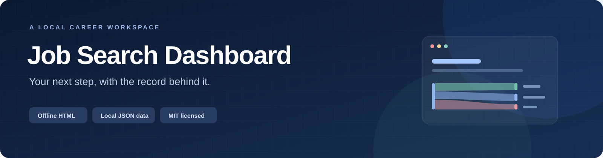

<br />

[](https://github.com/HenryVarro666/job-search-dashboard/actions/workflows/check.yml)
[](LICENSE)


**A local page for the jobs you are considering, the applications you sent, and what to do next.**

[Run the demo](#run-the-demo) · [Feature tour](#feature-tour) · [Search kit](#search-prompts-and-skills) · [Architecture](#how-it-works) · [中文说明](README.zh-CN.md)

</div>

---

Job Search Dashboard turns local JSON records into a self-contained HTML page. Review opportunities, keep application events in order, and see the next action without running a server or building a front end.

**Current source line: v4.** The v3 update refreshed the dashboard flow, tables and historical-application evidence. V4 packages **5 search prompts and 4 skills** with their own catalogs. [Version history](#versions) · [MIT license](LICENSE)

> Every interface image below is a real browser capture of the isolated **fictional demo**. Company names, jobs, salaries, dates and outcomes are synthetic. They illustrate features, not the author's job-search results. The interface is primarily Chinese.

## Run the demo

Requires **Python 3.10+**. No third-party Python package, API key, database or web server is needed for the demo.

```bash
git clone https://github.com/HenryVarro666/job-search-dashboard.git
cd job-search-dashboard
python3 scripts/demo.py
```

Open the printed file in a browser:

```text
.local/demo/工具/求职进度面板/dashboard.html
```

The demo rebuilds its dedicated `.local/demo/` directory from fictional fixtures. It does not read a personal vault. Its offline ATS and LinkedIn query plans are examples of intended work, not search results.

## Feature tour

### Start with the next action

| Today / 今天 | Recent discoveries / 近7天新发现 |
|---|---|
| Upcoming actions, role deadlines and decisions that need your input. Priority reasons and unresolved conditions remain available. | See roles first discovered in the last seven reporting days. First discovery, job publication and verification are separate dates. |
| [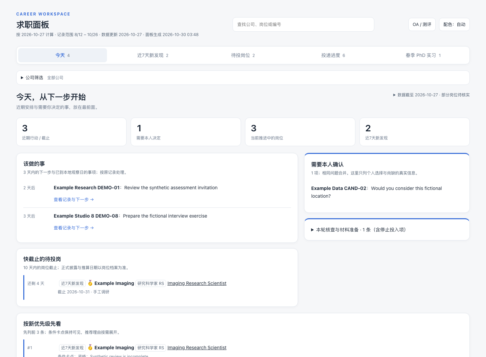](docs/assets/screenshots/01-today.png) | [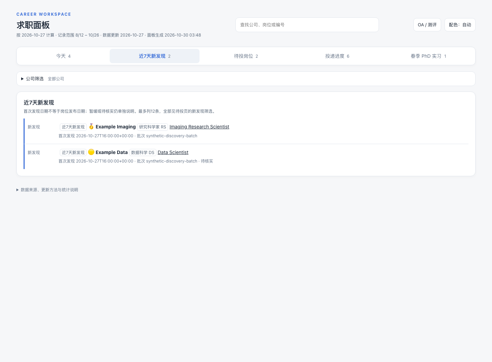](docs/assets/screenshots/02-discovered.png) |

### Keep opportunities separate from applications

| Opportunities / 待投岗位 | Internships / 春季 PhD 实习 |
|---|---|
| Filter by company, role type and priority. Inspect requirements, salary notes, sources and listing availability before investing in an application. Open, closed and unverified stay distinct. | Review a separate pool with start windows, duration, enrollment, return-to-school and authorization conditions. Personal declines and archived listings retain their reasons. |
| [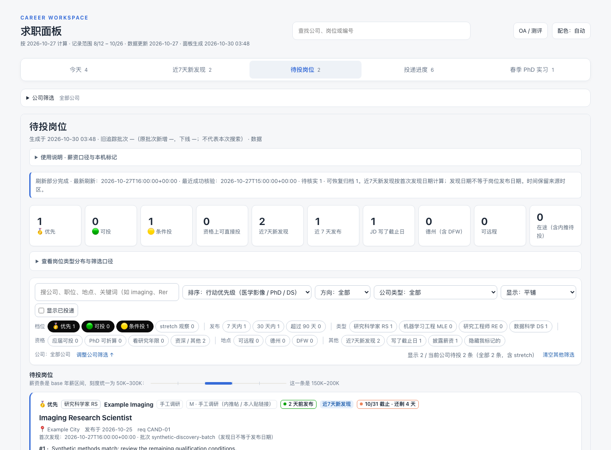](docs/assets/screenshots/03-opportunities.png) | [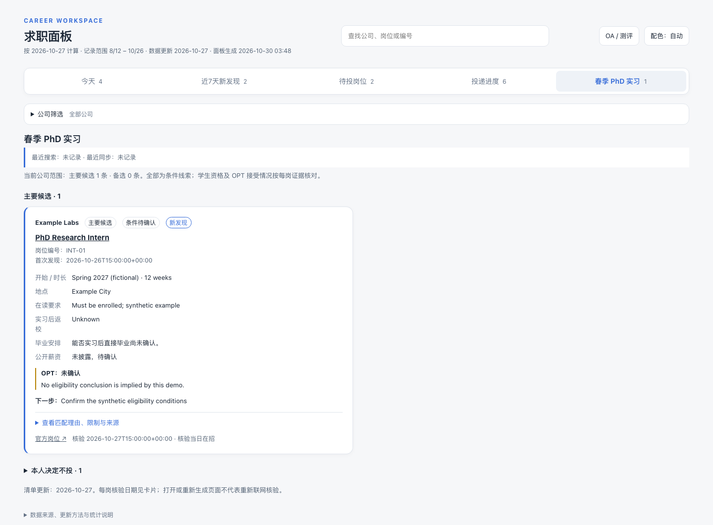](docs/assets/screenshots/04-internships.png) |

### Follow the application record

| Current progress / 当前推进 | All records / 全部记录 |
|---|---|
| Focus on active conversations, assessments and next steps. Ended or archived records remain available in the history. | Search exact requisitions and review records with company, stage and date filters. A referral request, a submission and an acknowledgment each keep their own meaning. |
| [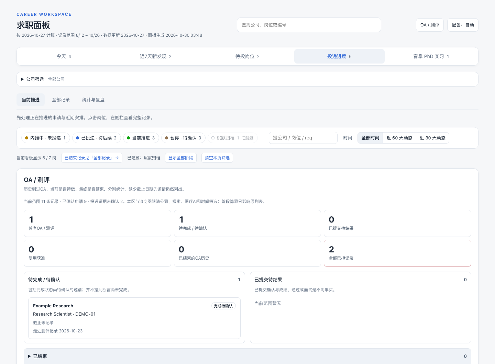](docs/assets/screenshots/05-progress-current.png) | [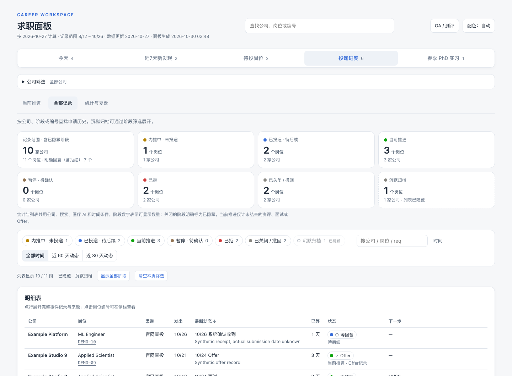](docs/assets/screenshots/06-progress-records.png) |

### Review activity and current outcomes

| Statistics / 统计与复盘 | Application flow / 申请去向 |
|---|---|
| Weekly application and referral activity, current-state counts and a per-role timeline. Missing submission dates stay unknown and do not become dated application activity. | One confirmed-application source leads to current outcomes, ordered from offer to rejection. Click a band to inspect its records, use the equivalent data table, or export the SVG. |
| [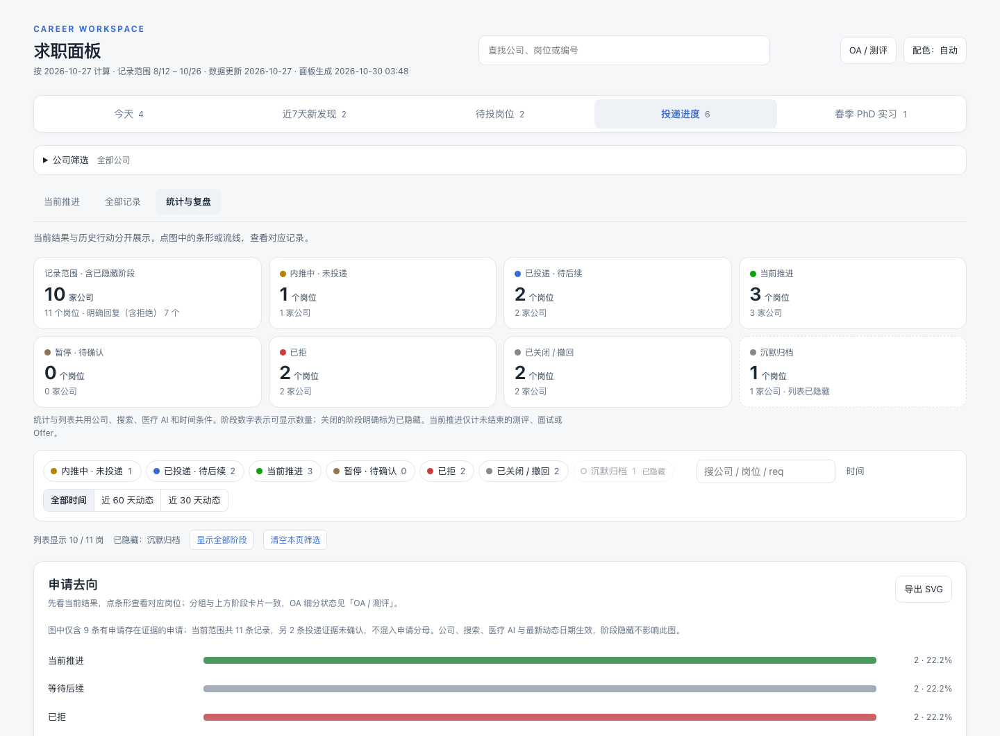](docs/assets/screenshots/07-progress-statistics.png) | [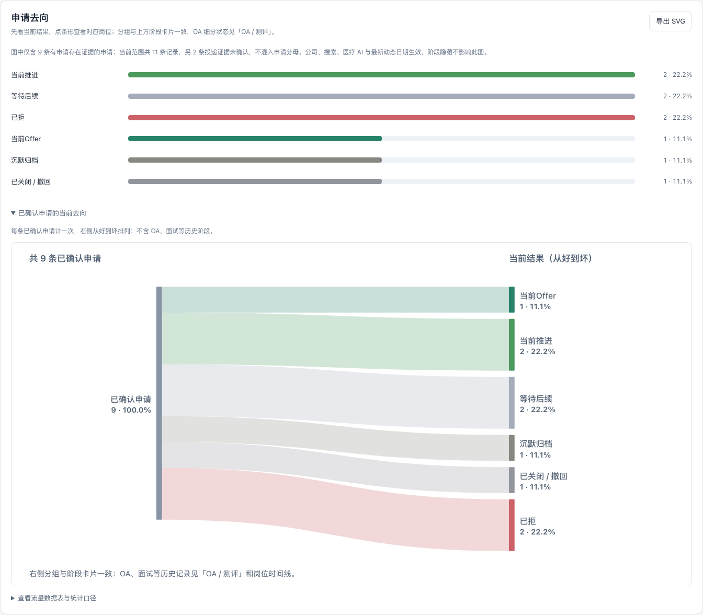](docs/assets/screenshots/08-application-flow.png) |

### Inspect the detail behind a count

| Record drawer / 岗位详情 | Assessments / OA 与测评 |
|---|---|
| Global lookup opens the exact application, candidate or internship. Inspect its history, sources and next action while preserving the surrounding filters. | Keep active, completion-unknown, submitted, reused and ended assessment records separate. An invitation is not a completed assessment. |
| [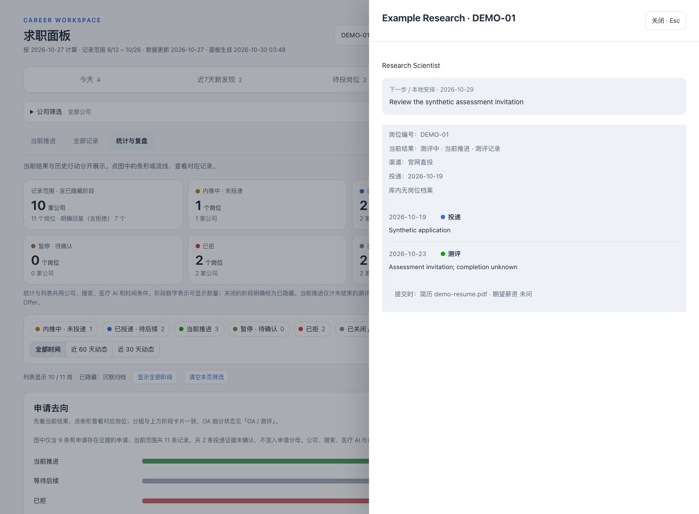](docs/assets/screenshots/09-detail-drawer.png) | [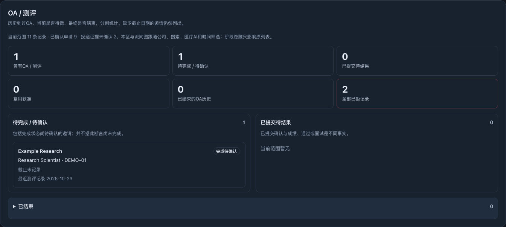](docs/assets/screenshots/11-oa-workspace.png) |

### A local page on different screens

| Dark mode / 深色模式 | Mobile / 手机视图 |
|---|---|
| Choose a theme across the outer dashboard and embedded opportunity board. | Cards adapt to a narrow viewport. Wide tables and charts retain their own scrolling areas. |
| [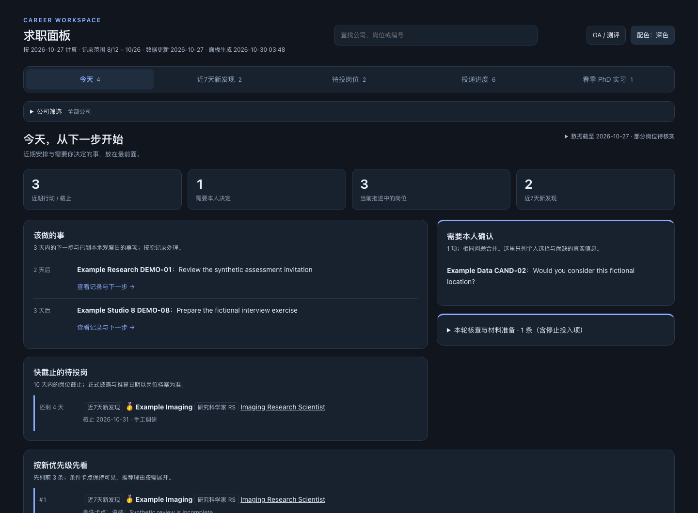](docs/assets/screenshots/10-dark-mode.png) | <a href="docs/assets/screenshots/12-mobile-today.png">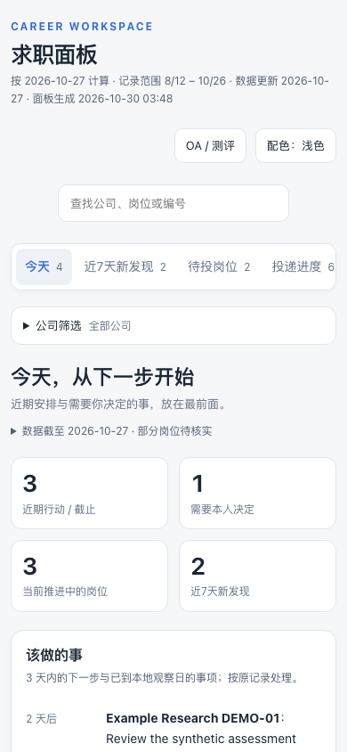</a> |

Click any image for the full capture. [Capture method and image provenance](docs/SCREENSHOTS.md)

## Search prompts and skills

The search kit describes the work around the dashboard: discovery, official verification, qualification review, evidence recording and local synchronization.

<table>
<tr><th>5 execution prompts</th><th>4 portable skills</th></tr>
<tr><td>

- [Manual full-time search](prompts/manual-fulltime-search.md)
- [Daily full-time ATS search](prompts/daily-fulltime-ats-search.md)
- [Daily internship search](prompts/daily-internships.md)
- [LinkedIn every three hours](prompts/linkedin-every-3-hours.md)
- [Handshake every three hours](prompts/handshake-every-3-hours.md)

</td><td>

- [LinkedIn hiring posts](skills/linkedin-hiring-post-search/SKILL.md)
- [Handshake discovery](skills/handshake-job-search/SKILL.md)
- [Sponsorship evidence](skills/sponsor-check/SKILL.md)
- [Postdoc fit](skills/postdoc-fit-search/SKILL.md)

</td></tr>
</table>

Start with the [prompt catalog](prompts/README.md), [skill catalog](skills/README.md), [blank candidate profile](docs/CANDIDATE_PROFILE.md) and [workflow guide](docs/SEARCH_WORKFLOW.md).

**Execution is configured separately.** The query planners generate offline search plans. An agent or person with search tools executes them, checks the exact official role and saves the evidence. Daily and three-hour templates do not install a scheduler. Logged-in account searches remain separately authorized. The package does not log into accounts, send messages, submit applications or upload resumes.

```bash
# Offline planning only; neither command searches the web.
python3 -B 工具/healthcare岗位抓取/search_plan.py --scope fulltime
python3 -B 工具/healthcare岗位抓取/linkedin_search_plan.py --scope fulltime
```

For optional configured ATS collection and review staging, see [collector setup](docs/CRAWLER_SETUP.md). Employer registries, candidate research and external review runners are not bundled.

## How it works

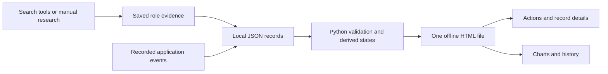

| Layer | Technology | Responsibility |
|---|---|---|
| Records | Local JSON | Applications, candidates, internship conditions and evidence dates |
| Generator | Python standard library | Validate records, derive states and inline data and assets |
| Interface | HTML, CSS and vanilla JavaScript | Tabs, filters, lookup, drawers and local display preferences |
| Charts | Inline SVG | Current outcomes, activity and timelines; flow SVG export |
| Development | `unittest`, Node.js and `jsdom` | Synthetic regressions, generated JavaScript checks and DOM integration |
| Optional capture | Playwright and Chromium | Reproduce the fictional screenshots with external requests blocked |

The generated dashboard loads local assets and has no remote analytics, fonts or runtime libraries. Selected source links open their destinations. Research and optional collectors can access external services when explicitly run.

### Records keep their evidence

- A referral request is not a submitted application. Submission and receipt dates remain separate.
- Confirmed employer evidence may establish that an application existed without establishing when it was submitted.
- A search result is a lead; discovery, publication and successful official verification have separate clocks.
- A blocked page is not evidence that a job closed. A listing closing is not an applicant rejection.
- Personal decisions stay in place when a later listing check changes availability. Silence archive is a reversible display rule.

Charts describe recorded history and current outcomes. They do not predict hiring results.

## Use your own records

Keep private inputs outside version control. Configure a reviewed profile and the existing source layout using the [workflow guide](docs/SEARCH_WORKFLOW.md), then run:

```bash
python3 工具/求职进度面板/make_dashboard.py --check
python3 工具/求职进度面板/make_dashboard.py
```

The generator accepts `--data`, `--out` and `--today`; companion candidate and internship inputs use the documented runtime layout. Rebuilding the HTML consumes saved local records and does not check live vacancies or read an inbox.

> A generated personal HTML page embeds its records. Keep it private along with applications, correspondence, resumes, account bindings and schedules. The repository ships blank or fictional examples only.

## Development

Requires Node.js 18+ for development checks, in addition to Python.

```bash
npm ci --ignore-scripts
python3 scripts/check.py
```

The suite runs **209 Python tests**, JavaScript regression files, a synthetic build, inline-script syntax checks and full-page DOM checks with network access disabled. The screenshot run adds real Chromium rendering, navigation and a narrow viewport. These checks do not test live ATS providers, authenticated accounts, scheduler execution or real submissions.

To reproduce the screenshot gallery with an optional Playwright development installation:

```bash
npm install --no-save --package-lock=false playwright
npx playwright install chromium
node scripts/capture_screenshots.cjs
```

`PLAYWRIGHT_MODULE` and `CHROMIUM_EXECUTABLE` can point to an existing local installation. Capture rebuilds the fictional demo and writes the gallery under `docs/assets/screenshots/`. [Screenshot documentation](docs/SCREENSHOTS.md)

<details>
<summary><strong>Repository map</strong></summary>

```text
scripts/                   Synthetic demo, regression runner and screenshot capture
prompts/                   Five execution templates and their catalog
skills/                    Four portable skills and supporting files
examples/                  Blank or fictional setup inputs
docs/                      Setup, workflow, release notes and screenshots
工具/
  求职进度面板/             Generator, interface, models and regressions
  healthcare岗位抓取/       Query planners, optional ATS collection and board modules
  岗位有效性检查/           Availability-check dependency
source-manifest*.json       Versioned export hashes and provenance
```

The original runtime paths remain compatible with existing local installations.

</details>

## Versions

| Version | Scope |
|---|---|
| [v4.0.0](https://github.com/HenryVarro666/job-search-dashboard/tree/v4.0.0) | Prompt and skill catalogs with setup guidance; inherits the v3 dashboard |
| [v3.0.0](https://github.com/HenryVarro666/job-search-dashboard/tree/v3.0.0) | Current-outcome flow, table fixes and historical-application evidence |
| [v2.0.0](https://github.com/HenryVarro666/job-search-dashboard/tree/v2.0.0) | Search workflows, query planners and optional configured ATS collection; Handshake followed on this source line |
| [v1.1.0](https://github.com/HenryVarro666/job-search-dashboard/tree/v1.1.0) | Redesigned views, detail drawer, lookup and corrected activity semantics |
| [v1.0.0](https://github.com/HenryVarro666/job-search-dashboard/tree/v1.0.0) | Archived runtime baseline with a fictional demo |

[Public release record](docs/PUBLIC_RELEASE.md) · [v4 notes](docs/V4_RELEASE.md) · [v3 notes](docs/V3_RELEASE.md) · [v2 notes](docs/V2_RELEASE.md)

## License and provenance

[MIT](LICENSE). Copyright 2026 Chao Cao. Third-party development dependencies retain their own licenses.

The layout was informed by [Job-Application-Tracker](https://github.com/MarioZhang420/Job-Application-Tracker). This implementation keeps its own Python/JSON runtime and chart semantics. README captures are real screenshots of the fictional demo; the older illustrative artwork is identified separately in [image provenance](docs/SCREENSHOTS.md).
