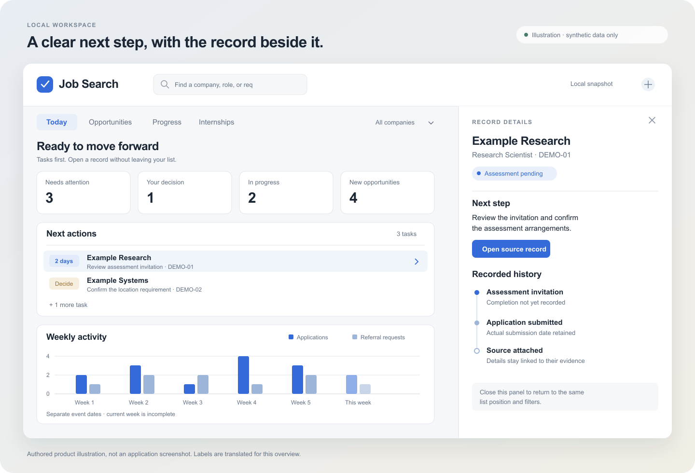
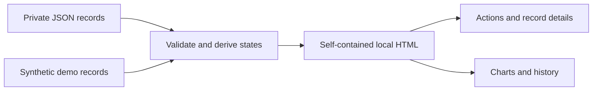

# Job Search Dashboard

A local workspace for job-search actions, opportunities, and application records. It turns private JSON files into a self-contained HTML page, with no web server or front-end build step required.

**Python standard library · Vanilla JavaScript · Offline HTML · SVG charts**

**v4.0.0** packages the five search prompts and four portable skills with dedicated catalogs and configuration instructions. It retains the latest dashboard changes from **v3.0.0**: a simplified current-outcome flow, readable tables, and employer-rejection evidence with unknown dates preserved. The prompt and skill bodies were already present on the v2 source line; v4 gives them a separate versioned package entry point.



*Illustrative demo layout with synthetic data, not an application screenshot. The artwork uses English labels; the current application interface is primarily Chinese.*

[Try the synthetic demo](#try-the-synthetic-demo) · [What it covers](#what-it-covers) · [How the data works](#how-the-data-works) · [Public-release preparation](docs/PUBLIC_RELEASE.md)

[Prompt catalog](prompts/README.md) · [Skill catalog](skills/README.md) · [Search workflow](docs/SEARCH_WORKFLOW.md) · [Candidate profile template](docs/CANDIDATE_PROFILE.md) · [v4 release notes](docs/V4_RELEASE.md) · [v3 release notes](docs/V3_RELEASE.md)

## What it covers

| View | Purpose | Details that stay visible |
|---|---|---|
| **Today** | Find the next useful action | Upcoming tasks, personal decisions, candidate recommendations, and unresolved conditions |
| **Opportunities** | Review jobs before applying | Priority, eligibility notes, official links, verification dates, and archived listings |
| **Application progress** | Follow each application through its recorded history | Assessments, next steps, outcomes, and links to supporting records |
| **Statistics** | Review activity and current states | Separate application and referral dates, explicit denominators, and detailed application flows |
| **Internships** | Review a separate candidate pool | Enrollment, return-to-school conditions, timing, and personal decisions |

The dashboard keeps actions close to their evidence: a detail panel beside the list, quick lookup across applications, candidates and internships, and separate progress views for current work, records, and statistics. State bars open matching records; the current-outcome flow starts expanded, with one confirmed-application source and outcomes ordered from offer to rejection. OA and interview history remain in the assessment view and record timelines. Weekly applications, referral requests, and receipts with unknown submission dates remain separate. The overview above illustrates the layout. See the [implementation plan](docs/superpowers/plans/2026-10-27-dashboard-round-one.md) for the original redesign scope.

## Try the synthetic demo

Requires **Python 3.10 or later**. The generator has no third-party Python dependencies.

```bash
git clone https://github.com/HenryVarro666/job-search-dashboard.git
cd job-search-dashboard
python3 scripts/demo.py
```

Open the HTML path printed by the command in a local browser. The demo builds an isolated copy under:

```text
.local/demo/工具/求职进度面板/dashboard.html
```

The supplied examples are fictional. The demo does not read or modify a personal vault. While this repository is private, cloning requires access to it.

The demo also writes unexecuted ATS and LinkedIn query plans under `.local/demo/discovery/`. These are offline plans, not search results or evidence that jobs are open.

## Search and verification

```bash
# Offline only: generate queries for a separate search tool or manual use.
python3 -B 工具/healthcare岗位抓取/search_plan.py --scope fulltime
python3 -B 工具/healthcare岗位抓取/linkedin_search_plan.py --scope fulltime
```

The ATS preset generates 30 full-time queries or 12 internship queries. LinkedIn generates 10 full-time entries: five public-index queries and five manual Posts entries. Its internship preset generates four entries, two per source. Both planners use America/Chicago for the default plan date; use `--date YYYY-MM-DD` when another reporting date is needed. Preset role families are starting points, not candidate eligibility decisions.

Public search, a readable hiring post, an official job check, and an application event are separate records. A recent post does not make a job newly published. Exact employer and requisition identity, hard qualification gates, source dates and access failures stay visible before a role enters the candidate pool. A dynamically rendered careers page may differ from a text extractor's fallback; resolve conflicting availability evidence before acting.

| Package | Use |
|---|---|
| `skills/linkedin-hiring-post-search/` | Public hiring-post discovery, manual Posts handoff, evidence and official-job verification |
| `skills/handshake-job-search/` | Authorized native search or scheduled public-index discovery, official verification and local sync |
| `skills/sponsor-check/` | Separate initial OPT, STEM OPT, H-1B and PERM evidence; reuse company findings by legal entity |
| `skills/postdoc-fit-search/` | Official postdoc vacancies, funding and appointment-specific conditions |
| `prompts/` | Manual full-time, daily ATS, daily internship and three-hour LinkedIn/Handshake workflow templates |
| `examples/` | Blank or fictional setup inputs; no personal records or active scheduler state |

Configure the [candidate profile](docs/CANDIDATE_PROFILE.md) before using the skills. Follow the [search workflow](docs/SEARCH_WORKFLOW.md) for evidence and synchronization. The optional registered-company collector requires local configuration and an explicit batch workspace; see [crawler setup](docs/CRAWLER_SETUP.md). It does not ship a private employer registry, a candidate's research archive, or an external LLM workflow runner.

Use the skills from this checkout, or install them in your agent's skill directory and provide the repository root in the task configuration. Their shared workflow and profile-template links assume the checkout layout; an installed copy must read those documents from the configured repository root. Supply a private profile and evidence workspace explicitly rather than copying personal inputs into the repository.

The prompt templates do not register a recurring task. A three-hour prompt describes one execution; configure a supported local scheduler separately if desired. The [Handshake prompt](prompts/handshake-every-3-hours.md) executes four configurable public-index queries and records authenticated account search as skipped. Logged-in LinkedIn Posts and Handshake searches remain authorized manual entry points. The package does not automate account login, social messages, applications or resume uploads.

## How the data works



Generation reads local records and embeds the required data, styles, and scripts into one HTML file. Reopening that file shows the saved snapshot. Rerun the generator after updating the source records.

| Recorded fact | Interpretation |
|---|---|
| Referral request | A request was sent. It is not proof of a submitted application. |
| Submission and acknowledgment | Actual submission and receipt dates remain separate. Missing dates stay unknown. |
| Assessment or interview record | Evidence of that stage, not automatic proof of completion. |
| Rejection or closure | A recorded outcome, not evidence of an earlier recruiting conversation. |
| Silence archive | A recoverable local display rule, not a rejection or withdrawal. |
| Job discovery and verification | Different timestamps. Rebuilding HTML is not a new search or availability check. |

Application-flow charts describe recorded stages and current outcomes. They do not imply that every application passed through the same sequence, and they do not predict employment outcomes.

## Use with local records

The original directory structure is retained for existing installations. When the private inputs are available locally, generate the dashboard with:

```bash
python3 工具/求职进度面板/make_dashboard.py
```

The generator accepts `--data`, `--out`, and `--today` for an application-record input, output path, and fixed reporting date. Candidate and internship inputs are resolved from their existing local paths. Use the isolated demo when trying the project without a configured installation.

```text
scripts/
  demo.py                      Synthetic example and local build
skills/                        Portable search and evidence-review skills; README catalog
prompts/                       Manual and recurring execution templates; README catalog
examples/                      Blank or fictional local-setup templates
工具/
  求职进度面板/                 Main dashboard
    make_dashboard.py          Validation, derived states, HTML generation
    oa_analytics.py            Assessment and application-flow semantics
    dashboard_template.html    Layout, interactions, and SVG charts
    company_filter.js          Shared company filtering
  healthcare岗位抓取/           Query planners, optional ATS collection, candidate-board modules
    search_plan.py             Offline ATS query plan
    linkedin_search_plan.py    Public-index queries and manual Posts handoff
    track.py                   Configured company increment and review staging
  岗位有效性检查/               Existing availability-check dependency
source-manifest.json            Source hashes for the v1 extraction
source-manifest-v2.json         v2 export hashes and portability notes
source-manifest-v3.json         v3 dashboard synchronization hashes
source-manifest-v4.json         v4 package hashes and validation scope
```

The supporting modules preserve the existing import structure. This repository does not contain the private research archive, crawler datasets, wage-reference files, or live application/scheduler state.

## Checks

Run the local regression checks and synthetic build with:

```bash
npm ci --ignore-scripts
python3 scripts/check.py
```

Python and Node.js 18 or later are required for this check command. The development-only `jsdom` dependency runs full-page DOM checks in memory with network access disabled. The checks also exercise synthetic Python and JavaScript cases, the discovery modules, and the offline planners, then regenerate the demo. They do not provide live ATS, browser layout or screenshot verification. No live accounts or private application data are required.

## Privacy and boundaries

Personal applications, correspondence, resumes, schedules, research notes, and generated private pages are excluded from version control. The demo output stays under the ignored `.local/` directory. The generated dashboard uses local assets rather than remote scripts, fonts, or analytics.

**A generated HTML file contains its embedded records.** Treat a page built from personal data as private, even though it is a single portable file. The dashboard does not replace an applicant portal, monitor an inbox, or verify live job availability when it is rebuilt. Source links open their destination only when selected.

## Versions

| Version | Purpose |
|---|---|
| [`v1.0.0`](https://github.com/HenryVarro666/job-search-dashboard/tree/v1.0.0) | Preserved runtime baseline before the first redesign, with a synthetic demo and limited portability cleanup |
| `v1.1.0` | Corrected stage inference, separate weekly activity series, progress subviews, record drawer, global lookup, and unified styling |
| `v2.0.0` | Search skills and prompt templates, offline ATS/LinkedIn planners, evidence regressions, and optional configured company increments |
| `v3.0.0` | Latest dashboard flow and table fixes, plus employer-rejection evidence without invented application dates |
| `v4.0.0` | Separate prompt and skill package catalogs, setup instructions and refreshed export hashes; inherits the v3 dashboard |

The v1 tag is retained for comparison. Its chart semantics predate the corrections described in the redesign plan.

## Before a public release

The repository is currently private. The [release preparation checklist](docs/PUBLIC_RELEASE.md) covers the source and history review, reproducible demo, documentation checks, and license decision needed before changing its visibility. **No open-source license has been selected yet.**
