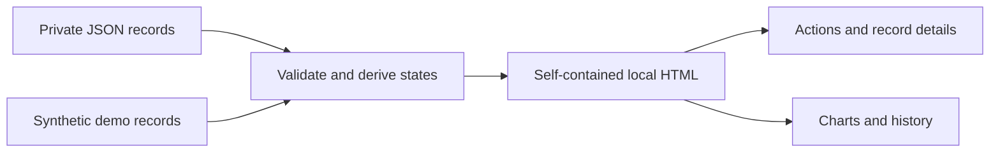

# Job Search Dashboard

A local workspace for job-search actions, opportunities, and application records. It turns private JSON files into a self-contained HTML page, with no web server or front-end build step required.

**Python standard library · Vanilla JavaScript · Offline HTML · SVG charts**


*Illustrative demo layout with synthetic data, not an application screenshot. The artwork uses English labels; the current application interface is primarily Chinese.*

[Try the synthetic demo](#try-the-synthetic-demo) · [What it covers](#what-it-covers) · [How the data works](#how-the-data-works) · [Public-release preparation](docs/PUBLIC_RELEASE.md)

## What it covers

| View | Purpose | Details that stay visible |
|---|---|---|
| **Today** | Find the next useful action | Upcoming tasks, personal decisions, candidate recommendations, and unresolved conditions |
| **Opportunities** | Review jobs before applying | Priority, eligibility notes, official links, verification dates, and archived listings |
| **Application progress** | Follow each application through its recorded history | Assessments, next steps, outcomes, and links to supporting records |
| **Statistics** | Review activity and current states | Separate application and referral dates, explicit denominators, and detailed application flows |
| **Internships** | Review a separate candidate pool | Enrollment, return-to-school conditions, timing, and personal decisions |

The dashboard keeps actions close to their evidence: a detail panel beside the list, quick lookup across applications, candidates and internships, and separate progress views for current work, records, and statistics. State bars open matching records; the detailed flow diagram expands on demand. Weekly applications, referral requests, and receipts with unknown submission dates remain separate. The overview above illustrates the layout. See the [implementation plan](docs/superpowers/plans/2026-10-27-dashboard-round-one.md) for its scope.

## Try the synthetic demo

Requires **Python 3.10 or later**. The generator has no third-party Python dependencies.

```bash
git clone https://github.com/HenryVarro666/job-search-dashboard.git
cd job-search-dashboard
python3 scripts/demo.py
```

Open the HTML path printed by the command in a local browser. The demo builds an isolated copy under:

```text
.local/demo/工具/求职进度面板/dashboard.html
```

The supplied examples are fictional. The demo does not read or modify a personal vault. While this repository is private, cloning requires access to it.

## How the data works



Generation reads local records and embeds the required data, styles, and scripts into one HTML file. Reopening that file shows the saved snapshot. Rerun the generator after updating the source records.

| Recorded fact | Interpretation |
|---|---|
| Referral request | A request was sent. It is not proof of a submitted application. |
| Submission and acknowledgment | Actual submission and receipt dates remain separate. Missing dates stay unknown. |
| Assessment or interview record | Evidence of that stage, not automatic proof of completion. |
| Rejection or closure | A recorded outcome, not evidence of an earlier recruiting conversation. |
| Silence archive | A recoverable local display rule, not a rejection or withdrawal. |
| Job discovery and verification | Different timestamps. Rebuilding HTML is not a new search or availability check. |

Application-flow charts describe recorded stages and current outcomes. They do not imply that every application passed through the same sequence, and they do not predict employment outcomes.

## Use with local records

The original directory structure is retained for existing installations. When the private inputs are available locally, generate the dashboard with:

```bash
python3 工具/求职进度面板/make_dashboard.py
```

The generator accepts `--data`, `--out`, and `--today` for an application-record input, output path, and fixed reporting date. Candidate and internship inputs are resolved from their existing local paths. Use the isolated demo when trying the project without a configured installation.

```text
scripts/
  demo.py                      Synthetic example and local build
工具/
  求职进度面板/                 Main dashboard
    make_dashboard.py          Validation, derived states, HTML generation
    oa_analytics.py            Assessment and application-flow semantics
    dashboard_template.html    Layout, interactions, and SVG charts
    company_filter.js          Shared company filtering
  healthcare岗位抓取/           Supporting candidate-board modules
  岗位有效性检查/               Existing availability-check dependency
source-manifest.json            Source hashes for the v1 extraction
```

The supporting modules preserve the existing import structure. This repository does not contain the full research archive, crawler datasets, or wage-reference files.

## Checks

Run the local regression checks and synthetic build with:

```bash
npm ci --ignore-scripts
python3 scripts/check.py
```

Python and Node.js 18 or later are required for this check command. The development-only `jsdom` dependency runs full-page DOM checks in memory with network access disabled. The checks also exercise synthetic Python and JavaScript cases and regenerate the demo. They do not provide browser layout or screenshot verification. No live accounts or private application data are required.

## Privacy and boundaries

Personal applications, correspondence, resumes, schedules, research notes, and generated private pages are excluded from version control. The demo output stays under the ignored `.local/` directory. The generated dashboard uses local assets rather than remote scripts, fonts, or analytics.

**A generated HTML file contains its embedded records.** Treat a page built from personal data as private, even though it is a single portable file. The dashboard does not replace an applicant portal, monitor an inbox, or verify live job availability when it is rebuilt. Source links open their destination only when selected.

## Versions

| Version | Purpose |
|---|---|
| [`v1.0.0`](https://github.com/HenryVarro666/job-search-dashboard/tree/v1.0.0) | Preserved runtime baseline before the first redesign, with a synthetic demo and limited portability cleanup |
| `v1.1.0` | Corrected stage inference, separate weekly activity series, progress subviews, record drawer, global lookup, and unified styling |

The v1 tag is retained for comparison. Its chart semantics predate the corrections described in the redesign plan.

## Before a public release

The repository is currently private. The [release preparation checklist](docs/PUBLIC_RELEASE.md) covers the source and history review, reproducible demo, documentation checks, and license decision needed before changing its visibility. **No open-source license has been selected yet.**
